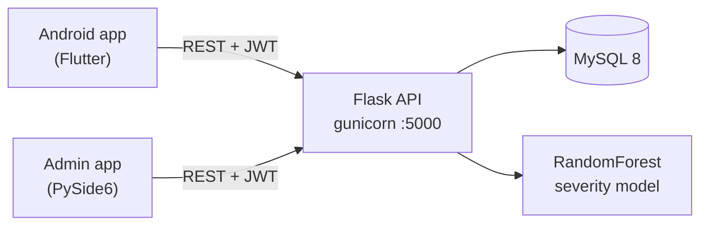

<div align="center">

# Accident Emergency Response System

**One tap on the phone. Nearest hospital, police and family get alerted. An ML model guesses how bad it is. The admin sees it live on a desktop dashboard.**

<br>


<br>

[What it does](#what-it-does) · [How it works](#how-it-works) · [Run it](#running-the-project) · [Precautions](#things-that-will-bite-you) · [Troubleshooting](#troubleshooting) · [Honest limitations](#what-is-real-and-what-is-simulated)

</div>

---

## Why I built this

In a road accident the first few minutes matter the most, and most people don't know who to call or what to say. I wanted a single big red button that does all of it: sends your location, tells the closest hospital and police station, informs your family, and gives the responders an idea of how serious the accident is before they reach.

This is my college major project. It has three parts that talk to each other:

- an **Android app** (Flutter) for the person in trouble
- a **Windows admin app** (PySide6) for whoever is monitoring accidents
- a **backend** (Flask + MySQL, in Docker) with an **ML severity model** inside it

## What it does

**Android app (14 screens)**

| # | Screen | What it is for |
|---|--------|----------------|
| 1 | Splash | Checks if you are already logged in |
| 2 | Login / Register | JWT based auth |
| 3 | Home | Big SOS button, Report Accident, My Location, Emergency Contacts |
| 4 | SOS Emergency | Confirm and send the alert |
| 5 | Accident Report | Type of accident, vehicle number, people involved, description |
| 6 | Live Location | Where you are right now |
| 7 | AI Severity | Minor / Moderate / Severe with a confidence score |
| 8 | Hospitals & Police | Nearest ones with distance and call button |
| 9 | Ambulance Tracking | Ambulance moving towards you (simulated) |
| 10 | Voice SOS | Say it in Hindi, Marathi or English |
| 11 | Family Notification | Who got informed |
| 12 | Blood Donors | Find donors by blood group |
| 13 | Accident History | Your past reports |
| 14 | Profile | Your details |

The app can also trigger an SOS on its own when the phone detects a sudden hit (accelerometer spike), after a short "Are you OK?" countdown.

**Windows admin app (11 pages)**

Admin Login, Dashboard (totals, trend chart, severity donut), Accident Management, Severity Monitoring, Live Accident Map, Hospital Management, Police Notification, Ambulance Management, User Management, Reports & Analytics, Accident History.

## How it works



What happens when someone presses SOS:

1. The app reads the location and sends it to `POST /api/sos` with the user's token.
2. The backend finds the nearest hospital and police station using a haversine distance query in SQL.
3. An accident row is created (status `pending`) and notification rows are written for the hospital, the police and every emergency contact of that user.
4. If the accident form was filled, `/api/predict` runs the RandomForest model and stores the severity.
5. The admin dashboard polls the API every few seconds and the new accident shows up.
6. The admin assigns an ambulance and updates the status. The app shows the change.

## Tech stack

| Layer | What I used |
|-------|-------------|
| Mobile | Flutter + Dart |
| Desktop admin | Python 3.12 + PySide6 (packaged with PyInstaller) |
| Backend | Flask, gunicorn, PyMySQL, flask-jwt-extended |
| Database | MySQL 8.0 |
| ML | scikit-learn RandomForest, saved with joblib |
| Packaging | Docker Compose (database + backend) |
| CI | GitHub Actions workflow that builds the APK |

## What is real and what is simulated

I would rather say this up front than have someone find out in the viva.

- **Hospitals, police stations, ambulances and blood donors are test data** seeded by `backend/seed.py` (Pune coordinates). Real integrations need official authorisation.
- **Alerts are rows in the `notifications` table.** No real SMS, call or push goes out yet.
- **Ambulance movement is simulated.**
- **The ML model is trained on generated data**, not on real accident records. The accuracy of about 81% only says the model learned the rules I used to generate the data. See [the ML section](#the-ml-model).
- **Demo location mode:** the app can send fixed Pune coordinates so that it matches the seeded hospitals. It is a flag in `mobile/aers_app/lib/api.dart` (`demoLocation`).

## Repository layout

```
.
├── docker-compose.yml        # db (MySQL) + backend (Flask)
├── .env.example              # copy to .env and fill in
├── backend/
│   ├── app.py                # auth, contacts, SOS, accidents, hospitals, health
│   ├── predict_api.py        # /api/predict
│   ├── extra_api.py          # endpoints for the later screens
│   ├── schema.sql            # creates the aers database and tables
│   ├── seed.py               # admin user + test hospitals, police, ambulances, donors
│   ├── model/
│   │   └── severity_model.joblib
│   ├── Dockerfile
│   └── requirements.txt
├── ml/
│   └── train.py              # makes the data, trains and saves the model
├── mobile/
│   └── aers_app/             # Flutter project
├── admin/                    # PySide6 desktop app
│   ├── main.py
│   ├── requirements.txt
│   ├── run_admin.bat
│   └── build_exe.bat
└── .github/workflows/
    └── build-apk.yml         # builds the APK on GitHub
```

## The ML model

| | |
|---|---|
| Task | Predict accident severity: Minor, Moderate or Severe |
| Inputs | vehicle type (Bike, Car, Bus, Truck, Other), people count, speed (km/h), impact in g (accelerometer peak), hour of day |
| Model | RandomForestClassifier, 150 trees, max depth 10 |
| Data | 6000 generated rows. A risk score from speed, impact, people, vehicle type and night time (plus noise) is split into three classes |
| Test accuracy | about 0.81 |

Example: a bike, 2 people, 80 km/h, 7 g impact at 11 pm comes back as Severe with a confidence of 0.99.

To retrain (no Python install needed, only Docker), from the project root:

```bash
docker run --rm -v "$PWD":/work -w /work python:3.12-slim sh -c "pip install -q scikit-learn numpy joblib && python ml/train.py"
docker compose up --build -d
```

If you have a real dataset (a Kaggle road accident file for example), replace `make_data` in `ml/train.py`.

## API

All endpoints except register, login and health need the header `Authorization: Bearer <token>`.

| Method and path | What it does |
|-----------------|--------------|
| `POST /api/register` | Create a user (name, email, password; phone and blood group optional) |
| `POST /api/login` | Returns the JWT, the role and the user |
| `GET /api/me` | Current user |
| `POST /api/fcm-token` | Save a device push token |
| `GET / POST /api/contacts`, `DELETE /api/contacts/<id>` | Emergency contacts |
| `POST /api/sos` | Body `lat`, `lng`. Creates the accident and notifies hospital, police and family |
| `POST /api/accidents` | Same as SOS plus type, vehicle number, people count, description |
| `GET /api/accidents` | Admin sees all, a normal user sees only their own |
| `GET /api/hospitals/nearby?lat=&lng=` | 10 nearest hospitals with distance |
| `POST /api/predict` | Severity and confidence from the model |
| `GET /api/health` | Returns `{"status":"ok"}` |

The extra screens (donors, ambulances, admin stats and so on) are served from `extra_api.py`.

**Tables:** `users`, `emergency_contacts`, `hospitals`, `police_stations`, `ambulances`, `accidents`, `notifications`, `donors`. The schema is in `backend/schema.sql` and MySQL creates it on the first start.

---

## Running the project

You need to do three things: start the backend, open the admin app, and get the Android app onto a phone. The phone can talk to the backend over a **USB cable** or over **Wi-Fi**. Both are covered below.

### 1. What to install

| Tool | Needed for | Notes |
|------|-----------|-------|
| [Git](https://git-scm.com/downloads) | cloning the repo | |
| [Docker Desktop](https://www.docker.com/products/docker-desktop/) | backend + database | Turn on the WSL 2 backend when it asks. Docker Engine inside WSL2 Ubuntu works too |
| [Python 3.12](https://www.python.org/downloads/) | admin app | Tick "Add python.exe to PATH". Very new versions (3.14 and up) may not have PySide6 wheels |
| [Flutter SDK](https://docs.flutter.dev/install/windows) | building the mobile app | Add `flutter\bin` to PATH, then run `flutter doctor` |
| [Android Studio](https://developer.android.com/studio) | Android SDK, platform tools, NDK | See the list below |
| A phone with USB debugging | testing | Android 8 or newer |

In Android Studio, open **SDK Manager** and install: an Android SDK Platform, **Command-line Tools**, **Platform-Tools** (this gives you `adb`), and under SDK Tools tick *Show Package Details* and install **NDK (Side by side) 28.2.13676358**. Then accept the licences:

```powershell
flutter doctor --android-licenses
flutter doctor
```

Flutter itself does not need Android Studio to be open, only the SDK it installed.

**Disk space:** keep at least **10 GB free on C:**. Flutter, the Android SDK and NDK, Gradle caches and Docker images add up, and a full disk makes builds fail with strange errors (`errno = 112`, read-only filesystem).

If you do not want any of the Flutter and Android tooling on your laptop, skip to [Option C](#option-c-build-the-apk-on-github-actions) and let GitHub build the APK.

### 2. Get the code

```powershell
git clone https://github.com/AddyKhan257/Accident-emergency-response-system.git
cd Accident-emergency-response-system
```

Keep the folder out of OneDrive and avoid very long paths. OneDrive sync breaks virtual environments and build folders.

### 3. Start the backend

Create the environment file:

```powershell
Copy-Item .env.example .env
```

Open `.env` and set the values:

```
DB_PASSWORD=choose-something
DB_NAME=aers
JWT_SECRET=choose-a-long-random-string
```

Open Docker Desktop and wait until it says the engine is running. Then:

```powershell
docker compose up --build -d
docker compose ps
```

Both `aers-mysql` and `aers-backend` should be up. The first build takes a few minutes.

Load the sample data. **Do this once only**, running it again duplicates the hospitals:

```powershell
docker compose exec backend python seed.py
```

Check that the API is alive:

```powershell
curl http://localhost:5000/api/health
```

You should get `{"status":"ok"}`.

| Account | Email | Password |
|---------|-------|----------|
| Admin | `admin@aers.com` | `admin123` |
| Test user | `test@x.com` | `pass123` |

The admin account comes from `seed.py`. If `test@x.com` does not exist, just register it from the app.

> If you ever run the seed twice by mistake, `docker compose down -v` wipes the database volume. Bring it up again and seed once.

Useful commands:

```powershell
docker compose logs backend --tail 30   # when something is wrong
docker compose down                     # stop, data stays
docker compose up -d                    # start again
```

### 4. Run the admin app

```powershell
cd admin
py -3.12 -m venv .venv
.\.venv\Scripts\activate
pip install -r requirements.txt
python main.py
```

If PowerShell says running scripts is disabled, run this once and try the activate line again:

```powershell
Set-ExecutionPolicy -Scope Process -ExecutionPolicy Bypass
```

Log in with the admin account and open **Accident Management**. Keep it open while you test the phone.

After the first setup you can start it with `run_admin.bat`. `build_exe.bat` packages it into a single `.exe` with PyInstaller (this has to be done on Windows).

### 5. Get the app on the phone

First enable developer options on the phone: tap the build number seven times in *About phone*, then switch on **USB debugging**. On Xiaomi and Redmi phones also switch on **Install via USB** and **USB debugging (Security settings)**, otherwise the install is silently blocked.

Plug the phone in, tap *Allow* on the debugging prompt and check:

```powershell
adb devices
flutter devices
```

The phone should show as `device`. Note the device id, you will need it.

#### Option A: USB cable (most reliable, best for demo day)

The cable carries the traffic. `adb reverse` makes `localhost:5000` on the phone point to port 5000 on the laptop, so no IP address is involved.

```powershell
cd mobile\aers_app
flutter pub get
adb reverse tcp:5000 tcp:5000
flutter run --release -d <device-id>
```

Do not pass `API_URL` here, the app defaults to `http://localhost:5000`. Run `adb reverse` again every time you replug the cable. If you unplug, the app stops reaching the backend.

#### Option B: Wi-Fi, no cable while using the app

The phone and the laptop must be on the **same Wi-Fi**. The cable is needed only once, to install.

**1. Find the laptop's Wi-Fi IP**

```powershell
ipconfig
```

Use the IPv4 address of your Wi-Fi (or Ethernet) adapter, something like `192.168.1.6`. Ignore the one under *vEthernet (WSL)* (usually `172.x.x.x`), the phone cannot reach it.

**2. Let port 5000 in.** Open PowerShell **as Administrator** (replace the IP with yours):

```powershell
netsh advfirewall firewall add rule name="AERS 5000" dir=in action=allow protocol=TCP localport=5000
netsh interface portproxy add v4tov6 listenaddress=192.168.1.6 listenport=5000 connectaddress=::1 connectport=5000
```

Docker listens on the IPv6 loopback on Windows, which is why the proxy forwards to `::1`. If the phone gets *connection reset* later, try forwarding to IPv4 instead:

```powershell
netsh interface portproxy delete v4tov6 listenaddress=192.168.1.6 listenport=5000
netsh interface portproxy add v4tov4 listenaddress=192.168.1.6 listenport=5000 connectaddress=127.0.0.1 connectport=5000
```

Check what is set up with `netsh interface portproxy show all`.

Two more settings that people forget:

```powershell
Set-Service iphlpsvc -StartupType Automatic
Start-Service iphlpsvc
```

The *IP Helper* service must be running or the proxy does nothing. And the Wi-Fi network must be set to **Private** (Settings, Network & Internet, your Wi-Fi, Network profile).

**3. Test from the phone's browser** before building anything:

```
http://192.168.1.6:5000/api/health
```

If you see `{"status":"ok"}` the network side is done. If not, fix this first, building the app will not help.

**4. Build with the laptop's IP baked in** and install over the cable:

```powershell
cd mobile\aers_app
flutter pub get
flutter run --release -d <device-id> --dart-define=API_URL=http://192.168.1.6:5000
```

When it opens on the phone, unplug the cable and log in. It works over Wi-Fi now.

The IP is part of the APK. **If the laptop's IP changes, the app has to be rebuilt** with the new one, and the portproxy rule has to be added again.

#### Option C: Build the APK on GitHub Actions

For when you do not want Flutter and the Android SDK on the machine at all.

1. Push the repo to GitHub (the workflow file is already in `.github/workflows/build-apk.yml`).
2. Open the **Actions** tab, choose **Build APK**, click **Run workflow**.
3. Put the backend URL in `api_url`, for example `http://192.168.1.6:5000`, and run it.
4. After about 6 to 10 minutes, open **Releases** and download `aers-app.apk` **on the phone**.
5. Allow *Install unknown apps* for the browser and install.

You still need the portproxy and firewall steps from Option B for the phone to reach the laptop.

### 6. Try it

1. Make sure Docker is running and the health URL works.
2. Open the app, log in with `test@x.com` / `pass123`.
3. Press the SOS button and send the alert. The result should show the nearest hospital and police station.
4. Look at **Accident Management** in the admin app. The new accident should be there.

---

## Things that will bite you

Learned the hard way while setting this up on more than one machine.

- **Docker has to be running.** After a reboot, open Docker Desktop first. (With Docker inside WSL it is `sudo service docker start`.) A phone error saying *connection reset* usually means the proxy is fine but the backend is not running.
- **The IP can change** after a restart or when the router hands out a new lease. Check `ipconfig` before a demo. Setting a static IP or a DHCP reservation for the laptop in the router settings avoids the problem.
- **The portproxy rule survives reboots, but it is tied to one IP.** A new IP means a new rule.
- **College or public Wi-Fi often blocks device to device traffic** (client isolation). If the browser test fails everywhere, use your phone's hotspot for the laptop, or use the USB option.
- **Run the seed once.**
- **"Token has expired"** means log in again. The lifetime is set in `backend/app.py` (`JWT_ACCESS_TOKEN_EXPIRES`).
- **Do not commit `.env`.** It is in `.gitignore`. The values in the examples are for local development only, change every secret before putting this on a real server.
- **The app uses plain `http`.** That is fine on a local network and is allowed through the cleartext setting in the Android manifest. Use HTTPS before any real deployment.
- **Laptop sleep kills the backend.** Turn off sleep while testing, and keep it plugged in.
- **Keep disk space free.** Docker, Gradle and the NDK are heavy.
- **Keep a cable in the bag on demo day.** It is the one option that does not depend on Wi-Fi.

## Troubleshooting

| What you see | Likely reason | What to do |
|--------------|---------------|------------|
| Phone browser: connection timed out | Wrong IP (often the WSL one), firewall, or Wi-Fi client isolation | Use the Wi-Fi IPv4 from `ipconfig`, check the firewall rule and the Private network profile, try the hotspot |
| Phone browser: `ERR_CONNECTION_RESET` | Backend is not running behind the proxy | Start Docker Desktop, `docker compose up -d`, check `localhost:5000/api/health` on the laptop first |
| `failed to connect to the docker API ... dockerDesktopLinuxEngine` | Docker Desktop is not running | Open it and wait for the engine to start |
| `flutter` is not recognized | Flutter is not on PATH | Add `flutter\bin` to PATH and restart the terminal |
| `flutter run` asks for a device or crashes with several devices | More than one target | Pass `-d <device-id>` from `flutter devices` |
| Gradle: *Android Gradle Plugin version 9.1.0 is lower than Flutter's minimum 9.1.1* | Newer Flutter needs a newer AGP | In `mobile/aers_app/android/settings.gradle.kts` change the `com.android.application` version to `9.1.1` |
| Gradle: *sdkmanager did not install NDK* | NDK missing | Install NDK `28.2.13676358` from Android Studio's SDK Manager |
| `There is not enough space on the disk` (errno 112) | C: is full | Free 10 GB or more, then build again |
| App installs but says the device is not found / `adb: device not found` | Cable or debugging prompt | `adb kill-server`, `adb devices`, allow debugging again, try another cable |
| Install blocked on Xiaomi / Redmi | MIUI security | Enable *Install via USB* and *USB debugging (Security settings)* |
| `activate` blocked in PowerShell | Execution policy | `Set-ExecutionPolicy -Scope Process -ExecutionPolicy Bypass` |
| `No suitable Python runtime found` for 3.12 | Python 3.12 not installed | Install it from python.org and open a new terminal |
| Login works in the browser but the app says it can not connect | App was built with an old IP, or no `adb reverse` | Rebuild with the current IP, or run `adb reverse tcp:5000 tcp:5000` |

## Before a demo

- [ ] Laptop plugged in, sleep off
- [ ] Docker Desktop running, `docker compose ps` shows both containers up
- [ ] `http://localhost:5000/api/health` is OK on the laptop
- [ ] Laptop IP unchanged (`ipconfig`), `http://<ip>:5000/api/health` is OK on the phone
- [ ] Admin app open on **Accident Management**
- [ ] Ambulance Management: use *Reset all to available* so there are free ambulances
- [ ] USB cable and the backup plan (hotspot or cable) ready
- [ ] Say clearly which parts are simulated

## Where this can go next

- Real push notifications with Firebase Cloud Messaging (the token column and endpoint already exist)
- A real accident dataset for the model
- Real hospital, police and ambulance integrations
- CI for the backend (tests, Docker image build and push) and deployment on a cloud VM with HTTPS

## Author

Built by **Adnan** ([@AddyKhan257](https://github.com/AddyKhan257)).
